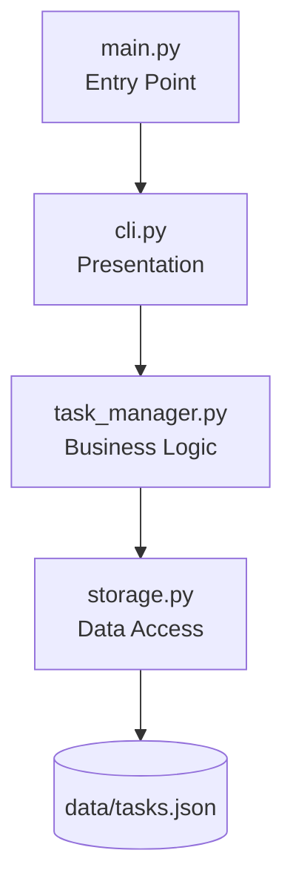

# Architecture Spine — QuickTask V1

## Design Paradigm

**Layered architecture** with strict downward-only dependency flow:

- **Presentation layer** (`cli.py`, `main.py`) — terminal menu, user I/O, raw input validation with re-prompt loops, display formatting
- **Business logic layer** (`task_manager.py`) — task CRUD operations, ID generation, statistics computation, operation-result messages
- **Data access layer** (`storage.py`) — JSON file read/write, directory/file initialization, corruption detection

Each layer depends only on the layer directly below it. No upward calls. No cross-layer skips (e.g., `cli.py` never touches `data/tasks.json`). Startup initialization (FR-7) flows through the same chain: `main.py` → `cli.run()` → first `task_manager` operation → `storage.load_tasks()`.



## Invariants & Rules

### AD-1 — Layered dependency direction

- **Binds:** all modules, all FRs
- **Prevents:** CLI coupling with storage internals; divergent data access paths that break when storage changes
- **Rule:** `cli.py` → `task_manager.py` → `storage.py` only. No module imports a layer two steps below. `main.py` imports `cli.py` only. `storage.py` imports nothing from this project. Violation = circular dependency or tight coupling.

### AD-2 — Single domain entity: Task

- **Binds:** FR-1, FR-3, FR-4, FR-5, FR-6
- **Prevents:** duplicate entity definitions with different shapes across modules
- **Rule:** `Task` is a dict with exactly these keys: `id` (str), `title` (str), `category` (str), `due_date` (str, YYYY-MM-DD), `completed` (bool), `created_at` (str, `YYYY-MM-DDTHH:MM:SS`, no microseconds — produced by `strftime("%Y-%m-%dT%H:%M:%S")`, never raw `isoformat()`). No `updated_at` field in V1 (task editing excluded).
- **Validation split (two stages, one pass each):**
  1. `cli.py` validates *raw user input* against the FR-1 re-prompt rules (empty title/category, date format `YYYY-MM-DD` via `strptime`, date value). It re-prompts until valid. `cli.py` passes only validated strings to `task_manager`.
  2. `task_manager.py` constructs the Task dict and defensively validates the constructed entity before persisting; if invalid it returns a failure result tuple (see AD-6) rather than raising.
- Past due dates are **allowed** (PRD §9 Q3) — no overdue flagging, no date-range rejection.

### AD-3 — Storage ownership, initialization, and atomic writes

- **Binds:** FR-1, FR-3, FR-4, FR-5, FR-7
- **Prevents:** multiple modules writing to `data/tasks.json` with different serialization or error handling, causing corruption or data races; first-run crashes from a missing file or directory
- **Rule:** `storage.py` is the sole module that reads from or writes to `data/tasks.json`. The file path is a constant inside `storage.py`. No other module imports `json` for task data purposes or references the file path directly. Storage exposes exactly two functions (see Interface Contracts):
  - `load_tasks()` — if the `data/` directory or `tasks.json` does not exist, returns `[]` (no exception, no side effect; the directory/file is created lazily on first save). If the file exists but is 0 bytes, returns `[]` (empty, not corrupt).
  - `save_tasks(tasks)` — creates the `data/` directory (`os.makedirs(..., exist_ok=True)`) if missing, then writes **atomically**: writes the full JSON to a temporary file in the same directory, then `os.replace()`s it over `tasks.json`. No direct `json.dump` to the target path.
- **Encoding:** the file is opened with explicit `encoding="utf-8"` on both read and write (never the platform default). `json.dump` uses `ensure_ascii=False` so the file stays human-readable; UTF-8 encoding makes this safe on all platforms.

### AD-4 — Write-through persistence, no shared state

- **Binds:** FR-1, FR-3, FR-4, FR-5, FR-6, FR-8
- **Prevents:** data loss on crash from buffered writes; stale in-memory state diverging from disk
- **Rule:** `task_manager.py` holds **no module-level task cache**. Every operation (view, add, complete, delete, statistics) calls `load_tasks()` fresh, operates on the returned list, and — for mutations — calls `save_tasks()` immediately after modifying it. There is no write buffer, no dirty flag, no deferred save, no session-long resident list. Consequence: statistics are always computed from actual stored data (PRD FR-6), and every save is a full-file atomic replacement (AD-3), so a crash mid-operation cannot lose previously completed operations or produce a truncated file.

### AD-5 — Task ID generation contract

- **Binds:** FR-1, FR-2, FR-4, FR-5
- **Prevents:** ID collision, stale ID references after deletion, divergent ID formats
- **Rule:** ID = `TASK` + a number zero-padded to **at least** 3 digits, computed as `max(existing numeric suffixes) + 1`. If no tasks exist, first ID is `TASK001`. Beyond 999, IDs grow naturally to 4+ digits (`TASK1000`) — padding is a minimum, not a cap, and no wraparound occurs. IDs are never reused after deletion — deleted `TASK003` means the next new task is `TASK004`. When computing max, records with a malformed or missing `id` are skipped (not crash, not counted). ID generation lives in `task_manager.py` (`generate_task_id`), not `storage.py`.

### AD-6 — Error handling boundary and message ownership

- **Binds:** FR-1, FR-3, FR-4, FR-5, FR-6
- **Prevents:** raw exceptions or storage internals leaking to the user-facing layer; two competing sources of user-facing text
- **Rule:**
  - `storage.py` raises exceptions (`FileNotFoundError`, `PermissionError`, `json.JSONDecodeError`). It never prints.
  - `task_manager.py` catches storage exceptions and returns result tuples `(success: bool, message: str, data)` — see Interface Contracts for the exact shape per function.
  - `cli.py` only receives result tuples and displays `message` verbatim. It never catches storage-level exceptions and never sees a raw exception from below.
  - **Message ownership (two disjoint sets):** `task_manager.py` owns *operation-result messages* — the PRD's fixed outcome strings ("Task created successfully! Task ID: {id}…", "Task not found, please check the Task ID.", "Data file is corrupted…", etc.). `cli.py` owns *interaction messages* — menu display, prompts, and input re-prompt messages ("Task title cannot be empty, please re-enter."). Neither layer writes strings belonging to the other set. No bare `except:` anywhere; `KeyboardInterrupt`/`SystemExit` propagate (Ctrl-C exits without saving — safe because every completed operation was already saved per AD-4).

### AD-7 — Corruption detection and the never-overwrite guarantee

- **Binds:** FR-3, FR-4, FR-5, FR-6, NFR-Reliability
- **Prevents:** silently overwriting a corrupt file and destroying all task history
- **Rule:** A file is *corrupt* if it is non-empty and either (a) `json.loads` fails, or (b) the parsed root is not a JSON array. `load_tasks()` raises `json.JSONDecodeError` (or `ValueError` for a non-array root) to signal this; it does not repair, reset, or replace the file. On corruption, **every** `task_manager` operation — read or write — returns `(False, <corruption message>, None)` and **never calls `save_tasks()`**. This closes the loop with AD-4: a corrupt file can never be overwritten by a subsequent add/complete/delete. Per-task schema validation (e.g., `completed` being a string instead of bool) is *not* corruption in V1 — see Deferred.

## Interface Contracts

Pinned signatures — no freedom left for divergent implementations. Result tuple shape is `(success: bool, message: str, data)` where `data` is `None` or the stated payload (never an omitted third element).

```python
# storage.py — only these two are public
def load_tasks() -> list:                    # [] if missing/empty; raises json.JSONDecodeError or ValueError if corrupt
def save_tasks(tasks: list) -> None:         # atomic write (AD-3); creates data/ dir if missing

# task_manager.py — all public; everything returns a result tuple unless stated
def add_task(title: str, category: str, due_date: str) -> tuple:   # (True, success_msg, new_id) | (False, err_msg, None)
def view_tasks() -> tuple:                                          # (True, "", tasks_list) | (False, err_msg, None)
def get_task(task_id: str) -> dict | None:                          # task dict or None (used by cli for delete confirmation display)
def complete_task(task_id: str) -> tuple:                           # already-completed → (True, "Task {id} is already completed.", None)
def delete_task(task_id: str) -> tuple:                             # (True, deleted_msg, None) | (False, err_msg, None)
def get_statistics() -> tuple:                                      # (True, "", {"total": int, "pending": int, "completed": int, "completion_rate": int}) — rate 0–100, 0 when no tasks
def generate_task_id(tasks: list) -> str:                           # TASK + max+1 (AD-5)

# main.py
def main() -> None:                                 # calls cli.run() and nothing else
```

`view_tasks` returns `data=""`-style empty message on success because the cli renders the list itself; `get_statistics` likewise — cli owns the display layout, `task_manager` owns the numbers. Empty-task-list cases return `(True, ...)` with empty data and the cli displays "No tasks recorded yet." (that string is a display-layout concern, owned by cli).

## Consistency Conventions

| Concern | Convention |
| --- | --- |
| Naming (files) | `snake_case.py` — `main.py`, `cli.py`, `task_manager.py`, `storage.py` |
| Naming (functions) | `snake_case` — `load_tasks()`, `save_tasks()`, `add_task()`, `view_tasks()`, `get_task()`, `complete_task()`, `delete_task()`, `get_statistics()`, `generate_task_id()` |
| Naming (variables) | `snake_case` — `task_list`, `task_id`, `due_date` |
| Data format (Task ID) | `TASK` + zero-padded (min 3 digits) sequential string (e.g., `TASK001`, `TASK1000`) |
| Data format (dates) | `YYYY-MM-DD` strings, validated via `datetime.strptime` in `cli.py` (input stage) |
| Data format (created_at) | `datetime.now().strftime("%Y-%m-%dT%H:%M:%S")` — no microseconds |
| Data format (JSON file) | Array of task dicts at root level: `[{...}, {...}]`, UTF-8, `ensure_ascii=False` |
| File path | `data/tasks.json` — hardcoded as a constant in `storage.py` |
| Result messages | Operation-result strings from `task_manager.py`; prompts/re-prompts from `cli.py` (AD-6) |

## Stack

| Name | Version |
| --- | --- |
| Python | 3.9+ (PEP 585 builtin generics used in annotations) |
| json (stdlib) | built-in |
| os (stdlib) | built-in (`os.makedirs`, `os.replace`, path constant) |
| datetime (stdlib) | built-in (`strptime`, `strftime`) |

No external dependencies. No `requirements.txt` needed for V1. Stdlib only — nothing in the contracts above requires anything beyond `json`, `os`, `datetime` (+ `tempfile` for the atomic-write temp file, stdlib).

## Structural Seed

```text
personal-assistant/
  src/
    main.py            # Entry point: main() -> cli.run()
    cli.py             # Presentation: menu loop, I/O, raw-input validation + re-prompt, result display
    task_manager.py    # Business logic: CRUD, ID generation, statistics, result tuples, entity construction
    storage.py         # Data access: load/save, dir init, atomic write, corruption detection
  data/
    tasks.json         # Created lazily on first save; load tolerates absence
  README.md            # Startup instructions
```

## Capability → Architecture Map

| Capability / FR | Lives in | Governed by |
| --- | --- | --- |
| FR-1: Add task | `task_manager.add_task()` + `cli.py` prompt & re-prompt flow | AD-2, AD-3, AD-4, AD-5, AD-6 |
| FR-2: Task ID generation | `task_manager.generate_task_id()` | AD-5 |
| FR-3: View all tasks | `task_manager.view_tasks()` + `cli.py` display | AD-2, AD-3, AD-4, AD-7 |
| FR-4: Mark complete | `task_manager.complete_task()` + `cli.py` prompt | AD-3, AD-4, AD-6, AD-7 |
| FR-5: Delete task | `task_manager.get_task()` + `delete_task()` + `cli.py` confirmation | AD-3, AD-4, AD-5, AD-7 |
| FR-6: Statistics | `task_manager.get_statistics()` + `cli.py` display | AD-3, AD-4 |
| FR-7: Start / menu / first-run init | `main.py` → `cli.run()` → first `load_tasks()` (returns `[]` if missing); dir/file created on first save | AD-1, AD-3 |
| FR-8: Exit | `cli.py` menu loop termination | AD-4 |
| NFR: Reliability | Atomic write-through (AD-3, AD-4) + never-overwrite-on-corruption (AD-7) | AD-3, AD-4, AD-6, AD-7 |
| NFR: Maintainability | Module separation across 4 files; pinned contracts | AD-1 |
| NFR: Security | No external calls, local-only data | AD-3 (storage isolation) |
| NFR: Usability | `cli.py` prompts + `task_manager` operation messages (disjoint ownership) | AD-6 |

## Deferred

| Item | Reason it can wait |
| --- | --- |
| Task editing implementation | Out of V1 scope (PRD Non-Goal). Architecture supports it: new function in `task_manager.py`, new prompt in `cli.py`, `save_tasks()` already exists. No structural change needed. |
| Search and filter | Out of V1 scope (V1.1). Architecture supports it: query functions in `task_manager.py`, optional display parameters in `cli.py`. No structural change. |
| Category management | Out of V1 scope (V1.1). Categories are free-text in Task entity. A category list module could be added without touching `storage.py` or existing CRUD functions. |
| Web migration (React + Django) | Out of V1 scope (V2.0). Layered architecture enables this: `task_manager.py` becomes the Django model/service layer; `storage.py` maps to Django ORM; `cli.py` is replaced by React frontend + DRF views. AD-1 dependency direction ensures no CLI-specific logic leaks into business logic. |
| Testing framework | Per-story decision. V1 can use `unittest` (stdlib) or `pytest`. No structural constraint. |
| Packaging (`pyproject.toml` / `setup.py`) | V1 runs via `python src/main.py`. Packaging deferred until distribution is needed. |
| Logging | V1 uses print-based output only. Structured logging can be added in `storage.py` and `task_manager.py` without changing interfaces. |
| Concurrency / locking | V1 is single-user, single-process. No concurrent access to `data/tasks.json`. File locking deferred. Atomic single-writer replacement (AD-3) is sufficient for V1. |
| Per-task schema validation | V1 treats "valid JSON array" as the corruption boundary (AD-7). Tasks with wrong field types inside a valid array are not detected — deferred to V1.1 if it proves to matter. |
| i18n | V1 user-facing messages are English only (per PRD). No message-catalog mechanism. |
| Comment coverage enforcement | PRD NFR 7.2 ("necessary comments for non-obvious logic") is satisfied per-story during implementation; no architecture mechanism needed. |
